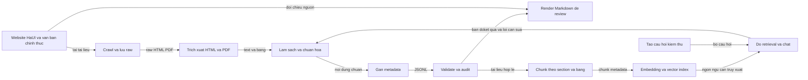

# Kịch bản trình bày pipeline dữ liệu

## Kịch bản nói ngắn

> Nhóm chúng tôi xây dựng chatbot tư vấn tuyển sinh dựa trên dữ liệu chính
> thức của Đại học Công nghiệp Hà Nội và các cơ quan nhà nước.
>
> Đầu tiên, chúng tôi xác định các nguồn cần thu thập như website tuyển sinh,
> trang thông báo, văn bản quy định và tài liệu PDF. Crawler tải nội dung cùng
> URL nguồn và lưu bản raw để có thể đối chiếu lại với tài liệu gốc.
>
> Tiếp theo, hệ thống trích xuất phần nội dung có ý nghĩa. Với HTML, chúng tôi
> bỏ menu, quảng cáo, script, footer và hình ảnh không cần thiết. Với PDF,
> chúng tôi trích xuất text theo từng trang và cố gắng giữ các bảng. Những
> thông tin dạng bảng được chuyển thành các dòng có tên cột đi kèm giá trị để
> không làm mất quan hệ giữa dữ liệu, ví dụ mã ngành và điểm chuẩn.
>
> Sau đó, dữ liệu được làm sạch: chuẩn hóa Unicode, xuống dòng, khoảng trắng,
> ký tự điều khiển và loại bỏ các phần phụ lục không phục vụ câu hỏi tuyển
> sinh. Chúng tôi đồng thời trích xuất metadata như tiêu đề, năm, ngày ban
> hành, số văn bản, loại nguồn và danh mục.
>
> Các tài liệu sau khi làm sạch được lưu ở JSONL. Mỗi dòng là một tài liệu,
> còn nội dung bên trong vẫn có thể chứa các đoạn văn và bảng. JSONL phù hợp
> cho máy đọc, còn khi review chúng tôi render sang Markdown để dễ đối chiếu
> với nguồn gốc.
>
> Trước khi đưa vào RAG, chúng tôi kiểm tra schema, ID, URL, ngày tháng,
> category, nội dung rỗng và tài liệu trùng lặp. Sau đó tài liệu được chia
> thành các chunk theo heading, mục đánh số và bảng. Mỗi chunk vẫn giữ ID tài
> liệu, section, năm và URL nguồn.
>
> Cuối cùng, chúng tôi tạo các câu hỏi kiểm thử từ những nhu cầu thực tế của
> thí sinh, chẳng hạn điểm chuẩn một ngành theo từng năm, điều kiện học bổng
> hoặc thủ tục đăng ký. Câu hỏi được dùng để đánh giá cả việc truy xuất đúng
> tài liệu và việc chatbot trả lời có căn cứ, không suy đoán.

## Sơ đồ pipeline

<!-- mermaid-checked: no \n, no em-dash/en-dash, no {} in labels, subgraphs are id["label"], arrows are -->|"label"|, all subgraphs closed by end, ids unique -->

## Câu chuyển ý khi thuyết trình

- **Thu thập:** “Chúng tôi ưu tiên nguồn chính thức và luôn giữ URL để truy
  xuất nguồn.”
- **Trích xuất:** “Mục tiêu không phải lấy toàn bộ HTML, mà lấy phần nội dung
  có ý nghĩa với câu hỏi tuyển sinh.”
- **Làm sạch:** “Chúng tôi chuẩn hóa hình thức nhưng không tự suy diễn hay
  bổ sung thông tin không có trong tài liệu.”
- **Chunking:** “Chunk được chia theo ý nghĩa của section, không cắt tùy tiện
  giữa tên ngành, điều kiện hoặc điểm số.”
- **Kiểm thử:** “Một pipeline tốt phải được kiểm tra bằng câu hỏi thật của
  thí sinh, không chỉ bằng việc dữ liệu có đúng schema.”
