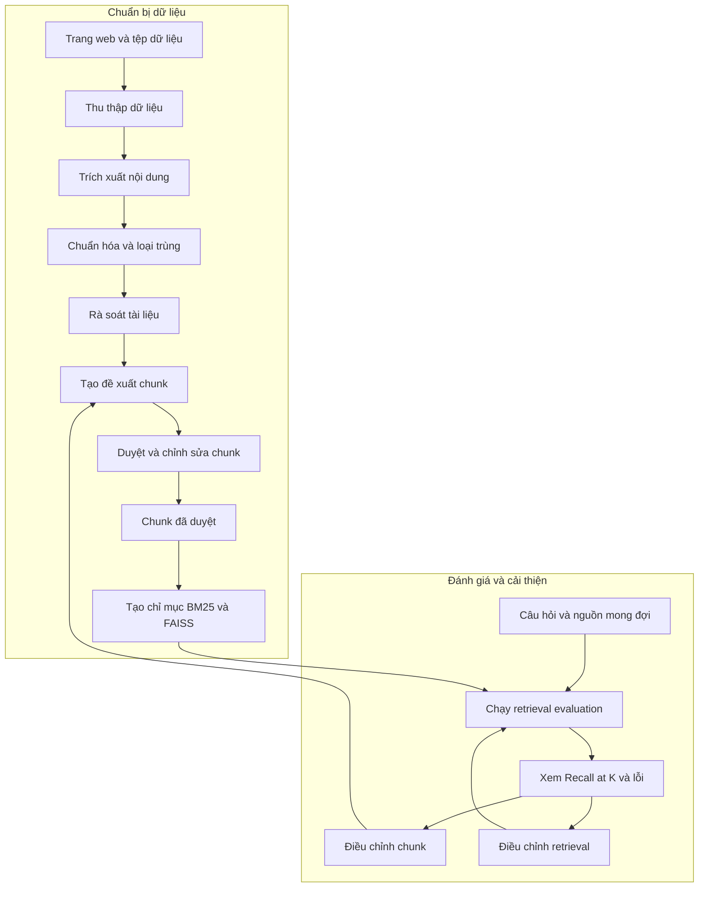
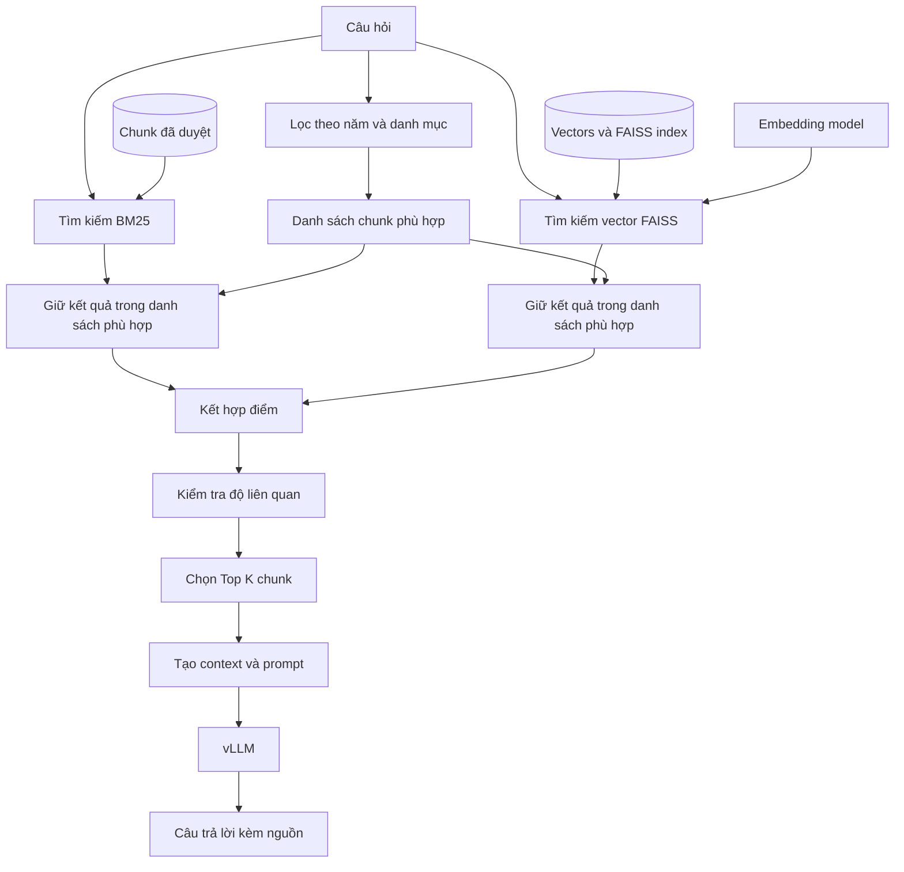
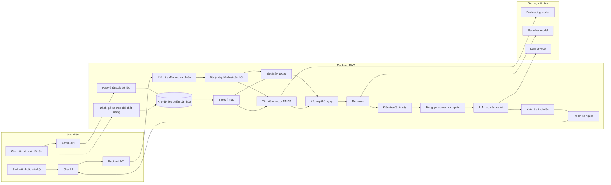

# Ba sơ đồ RAG - bản tiếng Việt

Các sơ đồ dưới đây là phiên bản giản lược của ba sơ đồ trong [README.md](./README.md). Sơ đồ 1 mô tả chuẩn bị và đánh giá dữ liệu, sơ đồ 2 mô tả luồng đang chạy trong CLI, còn sơ đồ 3 là kiến trúc đề xuất cho tương lai, chưa phải chức năng hiện có.

## 1. Chuẩn bị dữ liệu và cải thiện kết quả

<!-- mermaid-checked: no \n, no em-dash/en-dash, no {} in labels, subgraphs are id["label"], arrows are -->|"label"|, all subgraphs closed by end, ids unique -->

Tài liệu gốc và câu hỏi đánh giá được lưu riêng. Kết quả đánh giá giúp xác định nên sửa cách chia chunk hay cấu hình retrieval.

## 2. Luồng hỏi đáp hiện tại trong CLI

<!-- mermaid-checked: no \n, no em-dash/en-dash, no {} in labels, subgraphs are id["label"], arrows are -->|"label"|, all subgraphs closed by end, ids unique -->

CLI lọc kết quả BM25 và FAISS theo danh sách chunk phù hợp, sau đó kết hợp điểm và kiểm tra độ liên quan. Nguồn trong câu trả lời được dựng từ các chunk tìm thấy.

## 3. Kiến trúc Backend và Frontend đề xuất

<!-- mermaid-checked: no \n, no em-dash/en-dash, no {} in labels, subgraphs are id["label"], arrows are -->|"label"|, all subgraphs closed by end, ids unique -->

Đây là hướng phát triển có thể bổ sung Frontend, API, reranking, kiểm tra trích dẫn và công cụ đánh giá; cần đo chất lượng và độ trễ trước khi triển khai.
