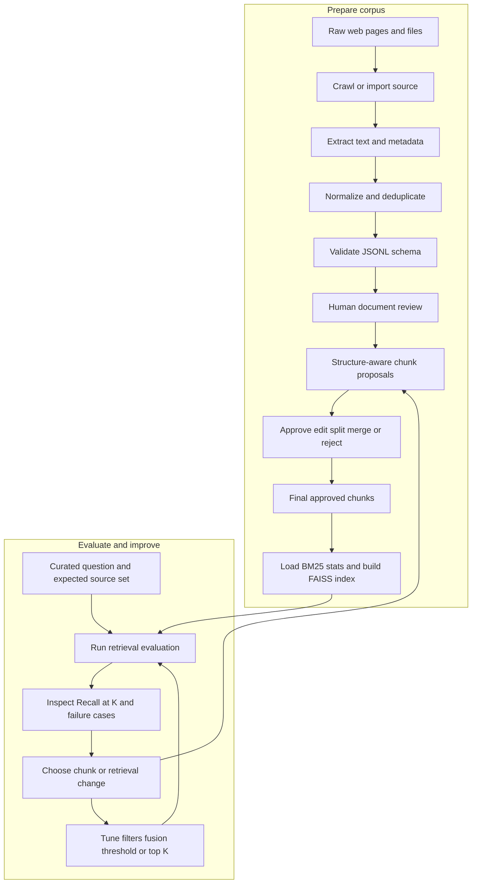
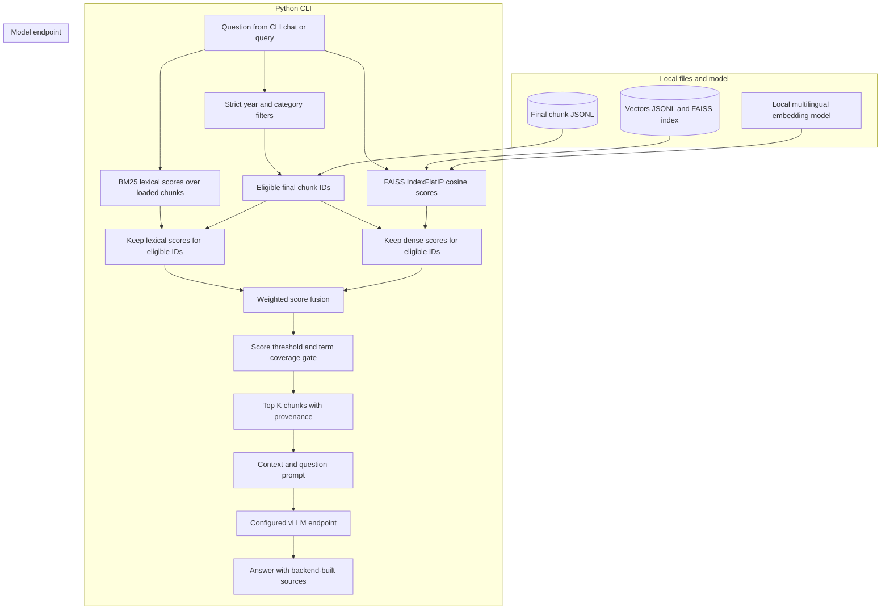
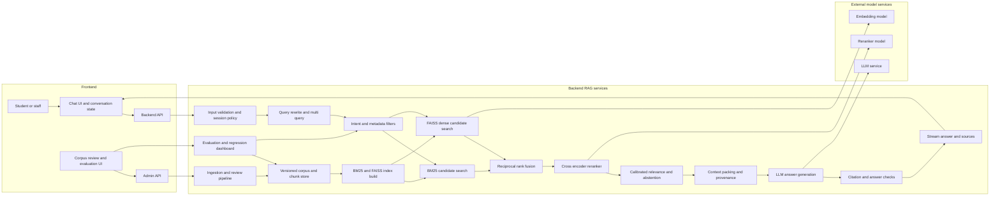

# HaUI RAG pipeline

The RAG code stays in Python modules and scripts; notebooks are optional
experiments, never the production pipeline.

## Three end-to-end diagrams

These diagrams distinguish the human data-preparation/evaluation loop, the
implemented CLI pipeline, and a possible later backend/frontend architecture.
The third diagram is still a target design for the ingestion/evaluation UI; the
chat backend itself now exists (`app/` + `frontend/`) and shares this package
through `rag/factory.py`. See `docs/architecture.md` for the implemented split.

### 1. Corpus preparation and evaluation feedback loop

<!-- mermaid-checked: no \n, no em-dash/en-dash, no {} in labels, subgraphs are id["label"], arrows are -->|"label"|, all subgraphs closed by end, ids unique -->


`data/documents/*.jsonl` remains the machine-readable source of truth. Review
Markdown edits document content; workflow state, chunk proposals, reviewer
decisions and final chunks are stored separately. Evaluation cases live in
`evaluation/questions.jsonl`; expected document/chunk IDs make misses
actionable and allow the same suite to compare chunking and retrieval changes.

### 2. Current retrieval and answer flow

<!-- mermaid-checked: no \n, no em-dash/en-dash, no {} in labels, subgraphs are id["label"], arrows are -->|"label"|, all subgraphs closed by end, ids unique -->


The CLI loads final chunks and derives eligible IDs from explicit year/category
filters. Today BM25 scores the loaded chunks and the hybrid retriever filters
those results to eligible IDs; FAISS also does exact dense search before its
results are restricted to those IDs. It fuses the surviving scores, applies
relevance gates, and passes selected chunks to vLLM. Sources are constructed
from retrieved chunks, not generated by the model.

### 3. Possible future optimized backend and frontend

<!-- mermaid-checked: no \n, no em-dash/en-dash, no {} in labels, subgraphs are id["label"], arrows are -->|"label"|, all subgraphs closed by end, ids unique -->


This target adds a frontend, API/session boundaries, rewrite and multi-query,
rank fusion, reranking, calibrated abstention, citation checks, streaming, and
an evaluation/review dashboard. Streaming, year eligibility, and CLI ingestion
are already implemented; remaining additions should be gated by measurable
improvement on the curated test set, latency budgets, and answer-quality review.

## Setup

```bash
uv sync
cp .env.example .env
```

The first semantic query downloads the configured multilingual embedding model
to the local Hugging Face cache. Model weights and generated vector indexes are
not committed. Configure `RAG_EMBEDDING_MODEL` only with a model supported by
FastEmbed. Generation settings are `LLM_PROVIDER`, `LLM_BASE_URL`, `LLM_MODEL`,
and optionally `LLM_API_KEY`; the older `VLLM_*` names still work as aliases, and
any OpenAI-compatible endpoint (vLLM, Ollama, external API) uses the same adapter.
See `docs/llm-providers.md`. The prompt packer keeps retrieved context under a conservative
15,000-character budget and bounds recent history before sending the request.
This leaves room for the configured 800-token output in the model's 8K window;
long chunks are explicitly marked as truncated rather than silently exceeding
the limit.

## Review one document independently

Open the resumable terminal review menu:

```bash
uv run python -m rag.cli review
```

Choose documents or chunks, then choose one of the 14 categories before seeing
that category's items. The picker displays ten at a time; enter `>` or `<` to
page and type a document/chunk ID, title, or text to filter. The displayed
numbers refer to the current filtered list, so later pages are reachable and
search is not limited to the first 20 records.

Documents are rendered to Markdown and opened in VS Code as a detached process
(`code --reuse-window`), so the terminal remains available and the Electron
warning messages do not pollute it. Save the Markdown in VS Code, switch back
to the terminal, then approve and save (`a`), save edits but leave pending
(`e`), reject (`r`), skip (`n`), or quit. Reject/skip do not apply unsaved
Markdown edits to source JSONL. Set `VISUAL` or `EDITOR` to override the
default opener.

The chunk menu distinguishes pending proposals from approved/final chunks.
Approving, editing, rejecting, splitting, or merging a proposal saves a review
decision to `data/chunks/reviewed/<category>.jsonl`; the generated proposal
file remains unchanged. Once every proposal for a document has a decision
(including any split/merge replacements), the CLI automatically writes the
approved/edited chunks to `data/chunks/final/<category>.jsonl`. Rejected and
superseded chunks are excluded. The menu also offers **Finalize fully reviewed
documents** for work completed before automatic finalization was available.

Final chunks remain editable from **Edit final chunks**. That action updates
both the reviewed decision and the matching final record directly, so unrelated
pending proposals cannot prevent an already-finalized chunk from being
amended. The embedding index refreshes the changed text on the next retrieval.
For multiline edits and splits, finish with `:save` on its own line or discard
with `:cancel`; a period is ordinary chunk content.

Render just the document being reviewed:

```bash
uv run python -m rag.cli render --document 05_tuition_scholarship_001
```

Edit only the content between the markers in
`data/review/05_tuition_scholarship/05_tuition_scholarship_001.md`, then apply
the edited content to the source JSONL:

```bash
uv run python scripts/apply_review.py \
  data/documents/05_tuition_scholarship.jsonl \
  data/review/05_tuition_scholarship
uv run python scripts/validate.py
```

Applying a review puts that document in `review_pending`; it does not silently
approve it. Approve or reject it explicitly:

```bash
uv run python -m rag.cli document-review status --document 05_tuition_scholarship_001
uv run python -m rag.cli document-review approve --document 05_tuition_scholarship_001
```

Other documents remain at their own status and can be reviewed in parallel.
The workflow states (`cleaned`, `review_pending`, `approved`, `rejected`,
`chunk_proposed`, `chunk_review`, `final`, `indexed`) do not replace the corpus
`status` field (`active`/`archived`).

## Propose, review, and finalize chunks

Chunk only an approved document:

```bash
uv run python -m rag.cli chunk --document 05_tuition_scholarship_001
```

Proposals are written to `data/chunks/proposals/<category>.jsonl`. They carry
document/source IDs, title, URL, category, year, heading path, source position,
content type, optional structured content, text, review status, and override
fields. The chunker groups heading sections and paragraphs, combines them up to
about 2,800 characters, and only falls back to sentence boundaries for an
oversized paragraph. It does not currently add overlap (`overlap_chars` is
ignored), and long tables or indivisible sentences are kept intact rather than
cut at an arbitrary character boundary.

This is structure-aware, deterministic chunking; it is **not** semantic or
recursive chunking. A recursive splitter does not inherently understand
meaning: it tries separators in order (for example heading, paragraph, line,
sentence, then word) until pieces fit a configured size, then packs adjacent
pieces back together. To try one, preserve heading metadata, use a tokenizer
budget rather than a character count, keep tables/lists intact, and test a
small overlap. A semantic splitter instead embeds adjacent sentences and
starts a new chunk when their similarity drops below a boundary threshold. It
can follow topic changes better, but needs threshold calibration and human
review; it can split a legal condition that is worded differently but still
logically connected.

For this corpus, first improve chunks manually with the existing `split`,
`merge`, and `edit` review actions. Then regenerate proposals for the document,
review and finalize them, and compare the same evaluation questions before
changing the production chunker. Record expected chunk IDs where possible.
Later, a recursive splitter can be added as an explicit strategy and compared
against the current strategy; avoid replacing the source or skipping review.

Inspect the proposal file, then decide each proposal. An edit is stored in
`text_override`; it does not rewrite the source document:

```bash
uv run python -m rag.cli chunk-review approve \
  --input data/chunks/proposals/05_tuition_scholarship.jsonl \
  --chunk-id 05_tuition_scholarship_001__section-001__chunk-001

uv run python -m rag.cli chunk-review edit \
  --input data/chunks/proposals/05_tuition_scholarship.jsonl \
  --chunk-id 05_tuition_scholarship_001__section-001__chunk-001 \
  --text-file /path/to/revised-chunk.txt
```

Other actions:

```bash
uv run python -m rag.cli chunk-review split \
  --input data/chunks/proposals/05_tuition_scholarship.jsonl \
  --chunk-id <chunk-id> --text-file /path/to/two-parts.txt

uv run python -m rag.cli chunk-review merge \
  --input data/chunks/proposals/05_tuition_scholarship.jsonl \
  --chunk-id <first-id> --other-chunk-id <second-id>

uv run python -m rag.cli chunk-review reject \
  --input data/chunks/proposals/05_tuition_scholarship.jsonl \
  --chunk-id <chunk-id> --note "Reason for rejection"
```

For `split`, the text file contains two non-empty parts separated by a line
exactly equal to `---CHUNK-SPLIT---`. The original chunk becomes `split`
(superseded), and two new pending proposals are created with `__a` and `__b`
suffixes. Review those child proposals separately; only approved or edited
children are eligible for final output.

For `merge`, the two source chunks must belong to the same document. Their text
and provenance are combined into a new pending proposal; the originals become
`merged` (superseded). Review the merged proposal separately.

Rejecting a chunk marks only that proposal `rejected` and records the optional
reason. It is excluded from final output; it does not delete or modify the
source document or other chunks. Rejecting a document instead sets its
workflow state to `rejected`, so it cannot be chunked until explicitly reviewed
again. Neither action removes the document from source JSONL.

Once every proposal (including split/merged replacements) has a decision,
promote the approved/edited chunks:

```bash
uv run python -m rag.cli finalize-chunks \
  --input data/chunks/proposals/05_tuition_scholarship.jsonl \
  --document 05_tuition_scholarship_001
```

If the source document changes and must be re-chunked, old decisions for that
document are not silently reused. Explicitly drop that document's obsolete
review records:

```bash
uv run python -m rag.cli chunk --document 05_tuition_scholarship_001 --replace-review
```

Final chunks are written to `data/chunks/final/`. Rejected or superseded
proposals are excluded. Finalization also invalidates neither source text nor
other documents' work; changing a document's review state makes its old final
chunks ineligible for retrieval until new chunks are finalized.

## Index and retrieve

The current query path has these stages:

1. Reject an empty question and apply strict metadata filters. If a year or
   category is inferred but no chunk matches it, return no results.
2. Score eligible chunks with BM25 and a multilingual embedding model.
3. Fuse lexical and semantic scores, then apply a score threshold and lexical
   term-coverage gate.
4. Sort survivors and return at most `top_k` chunks (default 5).
5. Put those chunks, with title/year/category/URL/heading provenance, into the
   vLLM prompt. The backend formats source metadata from the retrieved chunks.

### What the relevance threshold means

The default `RAG_SCORE_THRESHOLD=0.08` is a **minimum fused retrieval score**,
not a probability, model confidence, or guarantee that an answer is correct.
The fused score is:

```text
score = alpha * cosine_similarity + (1 - alpha) * (BM25 / max_BM25_for_query)
```

With the default `RAG_ALPHA=0.5`, each component has equal weight. BM25 is
normalized relative to the best lexical match for this question; the embedding
component is cosine similarity (negative values are clamped to zero in fusion).
A result must meet the fused threshold **and** have at least
`RAG_MIN_TERM_COVERAGE=0.3`. Coverage measures how much of the query's
meaningful vocabulary appears in the candidate text/title/heading. Semantic
similarity alone cannot bypass this lexical-evidence gate, which prevents
unrelated out-of-scope questions from reaching generation. Raising the
score/coverage thresholds tends to reduce irrelevant matches but can hide valid
evidence (lower recall); lowering them can return more weak matches. Tune on
the same labeled test questions, not by choosing a number that merely looks
intuitive.

An explicit year is a strict filter, not a preference: the system will not use
a nearby year as a fallback. Category hints work similarly when recognized.

### BM25 and embedding search

**BM25** is a lexical ranking function. This project case-folds query and chunk
text into word tokens and adjacent-word bigrams; its chunk text includes title,
section path, and content. For each query term, BM25 rewards its frequency in
a chunk and its rarity across the corpus, while normalizing for chunk length.
The implementation uses `k1=1.5`, `b=0.75`. It is good at exact names, program
codes, years, and distinctive words, but usually misses paraphrases and
synonyms. In simplified form, term contribution is
`IDF * tf * (k1 + 1) / (tf + k1 * (1 - b + b * chunk_length / average_length))`;
IDF grows when a term appears in fewer chunks.

**The embedding model** maps the title, heading path, and chunk text to a
numeric vector. Similar meanings can be close even when they do not share exact
words. The configured default is
`intfloat/multilingual-e5-large`. We compare vectors with cosine similarity,
which measures their angle rather than raw length. It helps with paraphrases,
but can confuse topics that are broadly related; that is why lexical scores,
metadata filters, and coverage remain useful.

**FAISS is now used for dense lookup.** The CPU `IndexFlatIP` index stores
float32, L2-normalized embedding vectors and searches them with inner product;
for normalized vectors, inner product equals cosine similarity. `IndexFlatIP`
is an exact flat index: it compares against every indexed vector, so it does
not intentionally approximate away neighbors or change the retrieval metric.
Its C++/vectorized implementation can reduce Python scoring overhead, though
it remains O(number of vectors times vector dimension); it may not be faster
end-to-end for this currently small corpus because model inference and disk I/O
can dominate. IVF/HNSW can reduce search work for much larger corpora, but
approximate candidates may affect recall and must be evaluated. FAISS stores
float32 values, so floating-point rounding can still reorder nearly tied
scores; compare the labeled evaluation set rather than assuming byte-for-byte
identical rankings.

The source vectors remain in `data/indexes/vector/vectors.jsonl`; FAISS's
binary index and its metadata are stored next to them. These are generated,
ignored files and can be rebuilt from finalized chunks. Changed chunk text
causes that document's vectors to be refreshed. Existing vector indexes created
before the FAISS change are upgraded from their saved vectors on the next query
or index build.

After pulling this change, install the new dependency and optionally prebuild
the dense index:

```bash
uv sync
uv run python -m rag.cli index --all
```

The first query also upgrades an existing JSONL-only vector index automatically.
Only changed chunks need new embeddings, while the exact flat FAISS index file
is regenerated from the saved vectors to keep its chunk-ID mapping consistent.

### How to optimize retrieval safely

1. Grow `evaluation/questions.jsonl` with real user questions, expected source
   documents/chunks, strict-year cases, follow-ups, and questions that have no
   answer. Current evaluation reports hit-rate/Recall@K; also track MRR or
   nDCG, no-answer false positives, p50/p95 latency, and human answer quality
   before calling a change better.
2. Diagnose failures by stage: wrong year/category candidate set, relevant
   chunk absent, relevant chunk ranked too low, threshold rejection, or
   answer-generation mistake. Fix the stage that caused the miss.
3. Compare chunk size/structure and overlap first when relevant evidence is
   missing or split. Compare BM25-only, dense-only, and hybrid retrieval;
   tune `RAG_ALPHA`, `RAG_SCORE_THRESHOLD`, coverage, and `top_k` on the same
   held-out questions.
4. Consider query rewriting or multi-query for ambiguous follow-ups only when
   evaluation shows a problem. Later, add a reranker over a small candidate
   set, then measure its quality gain against added latency. Preserve the
   original question and provenance for citations.
5. Change one variable at a time, keep a baseline, and avoid tuning on the
   final test cases used to claim quality.

Build or update the local persistent vector index:

```bash
uv run python -m rag.cli index --document 05_tuition_scholarship_001
uv run python -m rag.cli index --all
```

The first query builds the index automatically if it is absent, and retrieval
updates vectors whose final chunk text changed. The explicit index command is
useful to prebuild vectors before serving queries. Index files live in ignored
`data/indexes/` and can be regenerated from final chunks.

Retrieval-only and full RAG:

```bash
uv run python -m rag.cli retrieve --query "Học bổng mức 1 năm 2026 yêu cầu điều kiện gì?"

uv run python -m rag.cli --query \
  "Học bổng mức 1 năm 2026 yêu cầu điều kiện gì?" --show-context
```

The old `--query` invocation remains supported. The supported subcommand form
is `uv run python -m rag.cli query --query "..." --show-context`.

Start a direct interactive chat session:

```bash
uv run python -m rag.cli chat
```

Ask follow-up questions at the `Bạn:` prompt; recent turns are included so the
assistant can understand references to the preceding conversation. Type
`/clear` to start a fresh conversation or `/quit` (also `/exit`) to leave. The
older `uv run python -m rag.cli` invocation without `--query` still starts the
same interactive chat. Add `--show-context` to print retrieved chunks for
debugging.

Generation receives provenance-labelled context and is told not to invent
facts, use another year's data as the answer, switch an outside institution to
HaUI, or generate citation numbers. The backend constructs `sources` from
retrieved chunks (`source_id`, `chunk_id`, title, URL, year, category, score).
When the relevance filter rejects all candidates, generation is skipped and
`sources` is empty.

## Evaluation and extension

Add one JSON object per line to `evaluation/questions.jsonl`. A case can contain
`question`, `expected_document_ids`, `expected_chunk_ids`, `expected_year`, and
`notes`. `rag/test_questions.json` remains supported for the original basic
evaluation. The checked-in suite has 140 questions across all 14 corpus groups,
with dataset integrity enforced by `tests/test_evaluation_dataset.py`.

Useful checks:

```bash
uv run python -m unittest discover -s tests -v
uv run python -m rag.evaluate
```

The sample cases in `evaluation/questions.jsonl` include year-specific
cutoff-score questions, scholarship, tuition, admission methods, curriculum,
enrolment procedures, dormitory, student life/support, training regulations,
and institutional history. Add validated final chunks for a document before
expecting it to appear in retrieval.

Year-sensitive questions are scoped by `rag/eligibility.py`: explicit years win,
otherwise they default to 2026, and missing current-year evidence produces an
abstention. Evergreen topics (student life, support, dormitory context) stay
available without being treated as current-cycle proof.

No external vector database server, query rewriting, agentic retrieval, or FE
rendering is part of `rag/`; the chat API and frontend live in `app/` and
`frontend/`, and reuse this package through `rag/factory.py`.
